# Self-guided walkthrough

This guide takes you through the demo in about 30 minutes, on your own or as the script for a presenter. The demo itself (section 4) is **one script of six acts**: each act is a business requirement, and inside it are the steps to click, the SQL that proves each result, the technical detail, and what to say. Sections 5–9 are reference.

The data is synthetic. You can break anything: **Reset demo data** (top right of the UI) rebuilds everything in about 15 seconds.

> Dates in the screenshots reflect the day they were captured. Your "today" and the date stamped on your correction in Step 9 will be the day you run it.

**Contents**

0. [Technical summary: the PostgreSQL features in use](#technical-summary-the-postgresql-features-in-use) (one page, read first)
1. [The problem this demo addresses](#1-the-problem-this-demo-addresses)
2. [Two ideas you need first](#2-two-ideas-you-need-first)
3. [The cast](#3-the-cast)
4. [The demo: six acts, sixteen steps](#4-the-demo-six-acts-sixteen-steps) (the script; start here when presenting)
5. [How it works: technical reference](#5-how-it-works-technical-reference)
6. [Try it yourself in SQL](#6-try-it-yourself-in-sql)
7. [Exercises](#7-exercises)
8. [Limits, trade-offs and what changes in production](#8-limits-trade-offs-and-what-changes-in-production)
9. [What this demo covers, and what it does not](#9-what-this-demo-covers-and-what-it-does-not)

If you are presenting, read sections 1–3 once (about five minutes), then work through section 4 in order. It is a single script: six acts, and inside each act the steps to click, the SQL that proves each result, and what to say. Sections 5–9 are reference.

---

## Technical summary: the PostgreSQL features in use

A one-page map of everything the demo asks of PostgreSQL, and why. It runs on **Azure Database for PostgreSQL flexible server, PostgreSQL 17** (Burstable tier). You can see each item for yourself: in the SQL workbench, **The server and its extensions**, **Prove the trigger: change a fact, watch history appear, roll back** (a live proof that the history trigger works, rolled back afterwards), **The constraint and trigger that do the work**, **The one function that applies time and access**, **How the graph is stored: each label is a table** and **What PostgreSQL does for a visibility check**.

### The design in five lines

1. **Structure** (who connects to whom) is a property graph in **Apache AGE**; it carries no time and is append-only.
2. **Facts about each edge** (quote, page, confidence, who may read it, and two date ranges) are rows in an ordinary table, tied to the edge by its id.
3. **Time** is two PostgreSQL range columns: `valid` (true in the real world) and `sys_period` (when the platform knew it).
4. **History** is written by a trigger from the **`temporal_tables`** extension; a **`btree_gist`** exclusion constraint forbids contradictory valid periods.
5. **Time and access** are applied in exactly one SQL function, `kg_visible()`, which every hop of every query joins to.

### Extensions

| Extension (version) | What it provides | How the demo uses it | Why this one |
|---|---|---|---|
| **age** (1.7.0) | A property graph and the openCypher language, called as `cypher('graph', $$ MATCH … $$)` inside SQL | Four node types (`Party`, `Entity`, `Jurisdiction`, `Axiom`) and four edge types (`SERVES_AS`, `HOLDS_INTEREST_IN`, `GOVERNED_BY`, `HAS_RULE`). Every Cypher result joins to ordinary tables. | Multi-hop questions across the whole corpus, in the same database and transaction as the facts. Managed-service constraint: must be in `shared_preload_libraries` and `azure.extensions`, with a restart. |
| **temporal_tables** (1.2.2) | A trigger (`versioning(...)`) that archives old row versions and manages a system-time range | On `kg_assertion`: every `UPDATE` or `DELETE` copies the old row to `kg_assertion_history` and closes its `sys_period`. Also `set_system_time()`, used by the seed to backdate history. | Transaction-time history with no custom versioning code. A third-party extension (allow-listed on Azure, not actively developed); a hand-written trigger is the alternative. |
| **btree_gist** (1.7) | GiST operator classes for ordinary types, so a range and an equality can share one index | The exclusion constraint `EXCLUDE USING gist (element_id WITH =, valid WITH &&)`: one edge can never have two overlapping valid periods. | A plain unique constraint can't express "no overlapping ranges"; an exclusion constraint can, and the database enforces it. |
| **pg_trgm** (1.6), **fuzzystrmatch** (1.2) | Trigram similarity; phonetic and edit-distance functions | **Installed but not used by the demo.** Entity-resolution scores are pre-set in the seed data. | They are the building blocks a real name-matching stage would use. (Plain trigram similarity alone gets "Hank"/"Henrik" and the "Jr." case wrong; see the Q&A.) |

### Core PostgreSQL features

| Feature | Where | How it is used | Why |
|---|---|---|---|
| **Range type `tstzrange`** and the operators `@>` (contains) and `&&` (overlap) | `kg_assertion.valid`, `.sys_period` | A fact is valid at a date if `valid @> date`, known at a date if `sys_period @> date`. Ranges are half-open: the start is included, the end excluded. | "True when" and "known when" are first-class values the database understands, not two loose date columns. |
| **GiST indexes** | `(valid, sys_period)` on facts and on history; the exclusion constraint's own index | Speed up the range tests in `kg_visible`. | Range containment and overlap are what GiST is built for. |
| **Exclusion constraint** | `no_valid_overlap` on `kg_assertion` | Rejects any insert or update that would overlap valid periods for the same edge. | Integrity enforced by the database, not by application code. |
| **Triggers** | `kg_assertion_versioning` (`BEFORE INSERT OR UPDATE OR DELETE`) | Archives old versions automatically for corrections, amendments and withdrawals alike. | One mechanism for every kind of change; no application code writes history. |
| **`text[]` arrays and `&&`** | `kg_doc.acl`, `kg_user.principals` | A user may read a document when `acl && principals` (the arrays share at least one entry). | A compact, inspectable access list. No GIN index yet; that is the production step. |
| **`jsonb`** | `kg_assertion.props`, `er_decision.candidates` | Flexible per-fact attributes (role, the name as written, who amended it). Read with `->>`. | Fields that vary by edge type, without a column for each. |
| **SQL functions** | `kg_visible(valid_at, known_at, principals)` (table-returning, `STABLE`); `agstr()` (`IMMUTABLE`) | The single place that applies time and access; every hop of every query joins to it. | One rule in one place: a new endpoint can't forget a predicate. |
| **Views** | `kg_assertion_all` | `UNION ALL` of current rows and history, with an `is_current` flag. | Queries see one table of every version. |
| **Constraints** | Primary keys, foreign keys (`doc_id`), a `CHECK` on `kg_change_log.action` | Keep documents, facts and the change log consistent. | Basic relational integrity. |
| **Joins and SQL constructs** | `LATERAL`, `DISTINCT ON`, `string_agg`, materialised CTEs, `UNION ALL` | Per-hop visibility joins; the audit diff; the workbench queries. | A materialised CTE of visible rows was a **trap** for the main query (3.8 s); joining `kg_visible` per hop took it to about 0.15 s. |
| **Transactions and row locks** | `FOR UPDATE` in the correction and amendment endpoints | Two analysts can't resolve the same item twice; the second gets a conflict. | Safe concurrent changes. |
| **Read-only transactions, `statement_timeout`** | The SQL workbench | Any write is rejected by PostgreSQL itself; queries stop after 10 seconds. | A safe place for readers to experiment. |
| **The database clock, `now()`** | The app's "now" | Time-travel queries use the database's clock, not the app machine's. | `sys_period` is stamped by the database; a skewed app clock could hide a change made a moment earlier. |
| **System catalogs** | `pg_extension`, `pg_constraint`, `pg_trigger`, `pg_indexes`, `pg_get_functiondef` | The workbench reads them to show the constraint, trigger and function definitions. | Shows nothing is a black box. |

### Apache AGE specifics

| Item | Detail |
|---|---|
| Graph and labels | `create_graph`, `create_vlabel`, `create_elabel`. Each label is an ordinary table inside the graph's schema (`entity_graph."SERVES_AS"`). |
| Types | Properties are `agtype`; ids are `graphid`. There is no range type or exclusion constraint on a graph property, which is why time lives in `kg_assertion`. |
| Session setup | `SET search_path = public, ag_catalog` per connection. `LOAD 'age'` is not permitted on the managed service. |
| Limits found | No per-hop predicate on variable-length paths (`ALL(...)` is a syntax error); no relationship-type alternation (`[:A|B*1..2]`); no property access inside a list comprehension. See [section 8](#8-limits-trade-offs-and-what-changes-in-production). |

### Deliberately not used (and what they would add)

Row-level security (enforcement inside the database for any client), a GIN index on `acl`, `pg_partman` (monthly partitions of the history table), `pg_ivm` (a pre-computed "current" view), and `pgvector` (similarity search in the same database). Each is a sensible production addition; none is needed at this size.

---

## 1. The problem this demo addresses

A governance team holds the legal documents of a group of entities: agreements, amendments, notices. They want to answer questions across all of them, for example:

> *Which entities have a current director who also holds an ownership interest, and does a rule in force require an independent director?*

Four things make this hard in practice, and each one is built into the demo:

| Difficulty | What goes wrong with a conventional approach | What the demo does |
|---|---|---|
| **Time** | Documents amend each other; rules change. A single "current state" table can't tell you what was true last year. | Every fact carries a *valid* period (when it was true in the real world). |
| **Knowledge lag** | You often learn a fact long after it became true. A table keeps one date, so you can't reproduce what you believed on a past decision date. | Every fact also carries a *system* period (when the platform recorded it). |
| **Names** | "Hank" and "Henrik", "E. Hayes" and "Elena Whitman-Hayes": text matching silently misses them. | An entity-resolution layer maps surface names to canonical people, with a review queue. |
| **Access and mistakes** | A user must not infer hidden records from a visible path. Extraction errors must be correctable without erasing the audit trail. | Permissions are enforced at every hop; corrections supersede, never overwrite. |

The design: **a graph for structure, two clocks for time, an access check on every hop, and evidence under every answer.** It runs entirely in one PostgreSQL database.

---

## 2. Two ideas you need first

### Valid time and system time

| Clock | Question it answers | Example |
|---|---|---|
| **Valid time** | "When was this true in the real world?" | Amara Okoro became a director of Fabrikam Holdings on **2024-08-30**. |
| **System time** ("known as of") | "When did our platform learn it?" | The notice reached the platform on **2024-09-18**. |

Between those two dates, reality and the platform disagree. A **bitemporal** model keeps both, so you can ask either question, or both at once:

- *"Who was the director on 1 September 2024?"* (valid time only): Amara.
- *"Who did we **believe** was the director on 10 September 2024?"* (system time): nobody had been recorded yet.
- *"On 15 October 2025, using only what we knew that day, was entity X in conflict?"* (both): the audit question.

The demo's two sliders are exactly these two clocks.

### Structure versus facts

Rather than putting time inside the graph, the demo separates two things:

- The **graph** (Apache AGE) holds *structure only*: who is connected to what. Edges are never updated or deleted.
- A relational table, `kg_assertion`, holds the **facts about each edge**: the valid period, the system period, the source document, page, quoted sentence, confidence and the extractor version.

The graph tells you *what could be true*. The assertions tell you *whether, when, and on what evidence*. This keeps the graph simple and lets PostgreSQL's mature range types, constraints and versioning do the temporal work.

---

## 3. The cast

All fictional.

| Entity | State | Documents | Why it is in the demo |
|---|---|---|---|
| **Contoso Logistics LLC** | TX | Operating agreement (2016) and two amendments | Director changes over time; an *ambiguous name* leads to a wrong extraction that you correct in Step 9. |
| **Fabrikam Holdings Inc.** | CA | Shareholders' agreement (2018), succession notice (2024) | A **late-arriving notice**: effective 2024-08-30, recorded 2024-09-18. |
| **Litware Capital Partners LP** | TX | Partnership agreement (2020) | "Hank Lindqvist" vs "Henrik J. Lindqvist"; hit by a **late-arriving rule**. |
| **Tailspin Ventures LLC** | FL | Operating agreement (2022) | A corporate director with no overlap: correctly *not* flagged. |
| **Wingtip Health Cooperative** | CA | Bylaws (2023) | **Shared record-by-record**: visible to one named analyst, not to the California team. |
| **Adventure Works Reinsurance Ltd** | FL | Governance charter (2019) | "E. Hayes" alias; has the conflict *pattern*, but Florida has **no rule** in the data. |

**The two synthetic rules** (invented; not real law): in Texas, effective **2025-09-01** and recorded **2025-11-20**; in California, effective 2019-01-01. Each says: *a director who also holds an ownership interest requires an independent director.*

**Users** (the *Viewing as* menu)

| User | Can see | Can correct? |
|---|---|---|
| **Dana**, auditor | All entities | No (read-only) |
| **Priya**, TX/FL analyst | Texas and Florida entities, plus Wingtip (shared to her by name) | Yes |
| **Marcus**, CA analyst | California entities only (not Wingtip) | Yes |

**See the same thing in SQL:** these users, their roles and what each may read are rows in a table, not code. In tab **7 · SQL workbench**, run **Users, roles and what each may do** and **Who can read which document (the access matrix)** (Step 4).

---

## 4. The demo: six acts, sixteen steps

This is the script. Each **act** is one business requirement: what is needed, why it matters, and how it is solved. Inside each act are the **steps**: what to click in the UI, what you should see, the **SQL that proves it** (in the **7 · SQL workbench** tab, so the audience can see a real PostgreSQL database answering), and the technical detail. Each act ends with a line you can say. Allow about 20 minutes.

**Before you start:** open http://127.0.0.1:8765, set **Viewing as: Dana** and the scenario **Today · latest knowledge**, and click **Reset demo data** once.

**Optional 60-second opener (builds belief early):** open tab **7 · SQL workbench** and run **The server and its extensions** (a genuine Azure PostgreSQL server with Apache AGE, `temporal_tables` and `btree_gist`), then **The tables behind the demo, with row counts** and **The synthetic documents and who may read them**. Then return to tab 1 and begin Act 1.

> **Opening line:** "I'm going to show you six things your business needs to do with its governing documents, and for each one the exact mechanism behind it. After each, I'll show you the same answer as plain SQL, so you can see nothing is staged."

| Act | The business needs to… | How it is solved | Steps |
|---|---|---|---|
| [**1**](#act-1--ask-one-question-across-everything) | Ask one question across *every* document | Documents become a graph in Apache AGE inside PostgreSQL | 1, 1b |
| [**2**](#act-2--trust-the-answer) | Trust the answer: citations, no silent misses | A row per fact with its evidence; names resolved to people, with a review queue | 2–3 |
| [**3**](#act-3--each-person-sees-only-what-they-may-see) | Show each person only what they may see | One SQL function checks access on every hop | 4 |
| [**4**](#act-4--say-what-we-knew-on-the-day-of-a-past-decision) | Say what we knew on the day of a past decision | Two date ranges per fact: *true when* and *known when* | 5–8 |
| [**5**](#act-5--fix-errors-and-record-changes-without-erasing-history) | Fix errors and record changes without erasing history | One trigger archives every correction, amendment and withdrawal | 9–12 |
| [**6**](#act-6--know-the-limits-before-committing) | Know the limits before committing | A half-loaded corpus, deeper traversals and the PostgreSQL internals, tested and stated | 13–15 (16 resets) |

## Act 1 · Ask one question across everything

*About 3 minutes.*

> **The requirement:** "Which entities have a director who also holds an ownership interest, and does a rule in force require an independent director?" Across all documents, at once.
>
> **Why the business cares:** today that means a person reading documents one at a time. The answer is only as good as their patience, and nobody can re-run it next quarter.
>
> **How it is solved:** the documents have been turned into a graph. People, entities, jurisdictions and rules are nodes; *serves as director of*, *holds an interest in*, *governed by* and *has rule* are edges. The graph lives in **Apache AGE inside PostgreSQL**, so one query follows person → entity → jurisdiction → rule across the whole corpus. (Step 1 proves it in SQL, and Step 1b shows how the documents became that graph.)

### Step 1. Ask a corpus-wide, multi-hop question

**Do:** Tab **1 · Corpus-wide query**.

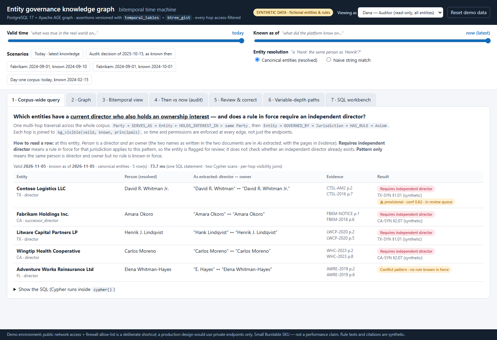

**You should see:** five rows. Contoso, Fabrikam, Litware and Wingtip are marked **Requires independent director**; Adventure Works is marked **Conflict pattern · no rule known in force**. Contoso also shows an amber **provisional** badge (confidence 0.62).

**How to read a row.** Each row is one entity where a single person is both a director and an owner. Read it as a sentence, for example Litware: *"Henrik J. Lindqvist is a director (document LWCP-2020, p.2, written as 'Hank Lindqvist') and also an owner (p.5, written as 'Henrik J. Lindqvist'). The Texas rule says that needs an independent director, so it is flagged."* The columns are: **Entity** (with state and role); **Person (resolved)** (the one real person the names refer to); **As extracted** (the name as written in the director document ↔ the ownership document); **Evidence** (the two documents and pages); **Result** (does a rule apply). **Requires independent director** means a rule in force applies to this pattern, so the entity is flagged for review; the demo does **not** check whether an independent director is already appointed. **Pattern only** means the same person is director and owner but no rule is known in force. The result is rule-based: the two rules are synthetic rows in the graph (`TX-SYN`, `CA-SYN`), not real law and not a model's judgement.

**Prove it in SQL** (tab **7 · SQL workbench**, group **Step 1 · The question**), in this order. Together they prove the "How it is solved" statement above:
1. **The graph's shape: what connects to what**: four kinds of edge between four kinds of node (Party → Entity twice, Entity → Jurisdiction, Jurisdiction → Axiom, which is the rule). The graph's whole design is these four rows.
2. **One chain: person → entity → jurisdiction → rule**: a single `MATCH` that follows the chain across the whole corpus. Note it lists *past* directors too (Lone Star, both Davids): the graph alone knows nothing about time or permissions.
3. **The full question: today, as an auditor**: the same chain with the "also an owner" condition, and every hop checked for time and access. It returns the same entities as Tab 1: one statement, with the graph query inside it.

(**The graph's edges: structure, no time** lists every edge by name if someone asks to see them one by one.)

**Why it works this way:** the question spans three kinds of relationship (person → entity twice, entity → jurisdiction → rule) across every document at once. Nobody opened a file. The result separates *a pattern is present* from *a rule applies*, so the system never overstates: Adventure Works has the pattern but Florida has no rule here.

**Under the hood:** click **Show the SQL**. It is one statement. Two Cypher scans run inside PostgreSQL via `cypher()`: one finds *person who serves as director of an entity and also holds an interest in it*; the other finds *entity → jurisdiction → rule*. Their results are joined to `kg_visible(...)` once per hop (see [section 5.4](#54-the-visibility-function-time-and-access-in-one-place)). It takes roughly 0.1 s here, including a round trip to the cloud.

### Step 1b. See how the documents became a graph

**Do:** open tab **7 · SQL workbench**, find the group **Step 1b · Documents to graph**, and run these in order.

**An honest note first.** The demo starts from documents whose facts are already extracted: `seed.py` is the stand-in for an extraction pipeline, so you will not see a model reading PDFs. What you *can* see, in SQL, is the lineage that pipeline produces. Every stage leaves rows you can query, and each row points to the next.

1. **The pipeline in five numbers**: documents registered → facts extracted → written names resolved to people → graph nodes → graph edges.
2. **The ingestion runs: when each batch of documents was loaded**: five dated batches. The corpus is loaded this way on purpose, so the platform's history reads as if each batch arrived on its real day.
3. **Trace one document into the graph, end to end**: for one document, the sentence extracted from a page, its confidence, the name as written ("Hank Lindqvist"), the person it resolved to ("Henrik J. Lindqvist"), and the graph edge it became. Change the document id to follow another.
4. **Names to people: the entity-resolution log**: every non-exact match, with method and score, including the 0.62 provisional match and the merge that was blocked by policy.
5. **How the graph is stored: each label is a table**, then **Peek inside one of those tables**: Apache AGE keeps every node type and edge type as an ordinary PostgreSQL table.

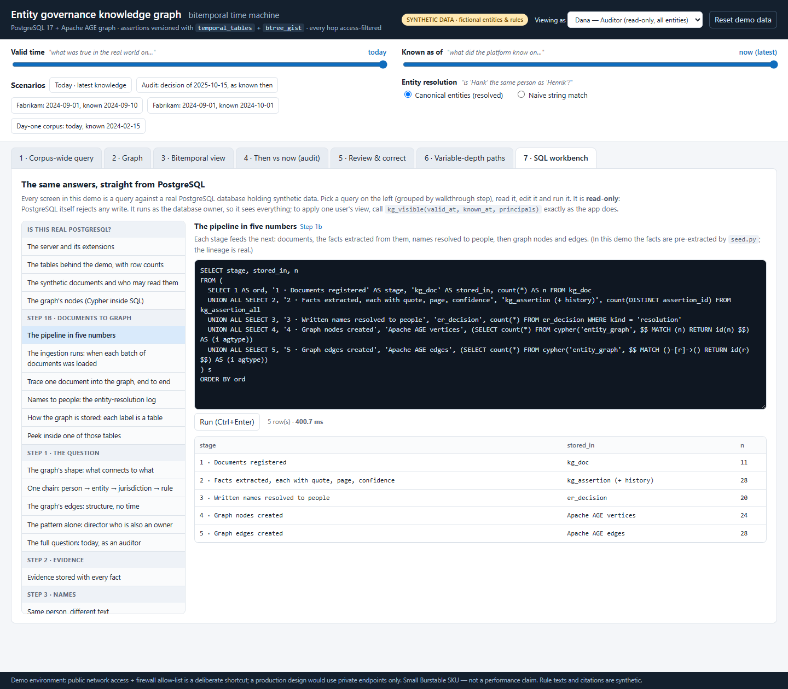

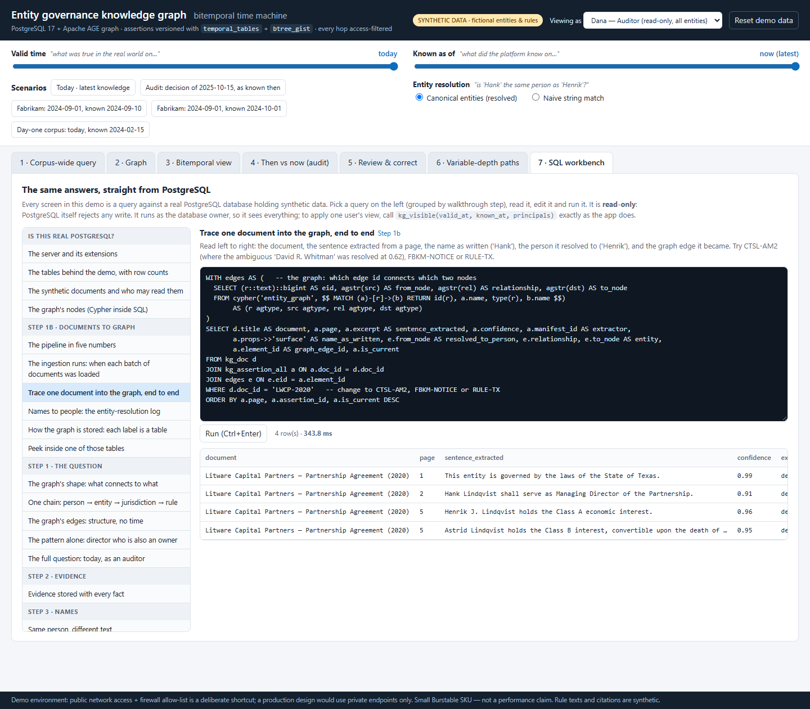

**You should see:** 11 documents become 28 extracted facts, 20 resolved names, 24 nodes and 28 edges; the trace shows one document's sentences turning into edges between named people and entities.

**Why:** the graph is not a separate system. Its nodes and edges are tables in the same database, and each extracted fact points to its edge by id. That one id is how the evidence (quote, page, confidence), the two time ranges and the access list all attach to a relationship.

> **Say it (end of Act 1):** *"Four entities come back, each with a citation, from one query across every document. And here is the same question as plain SQL: same rows. If someone asks whether that is every document: it is every document that has been loaded. Act 6 shows what an incomplete load looks like."*

---

## Act 2 · Trust the answer

*About 3 minutes.*

> **The requirement:** every answer must be defensible, and must never be quietly incomplete.
>
> **Why the business cares:** a wrong answer that *looks* complete is worse than an error. Names are the usual culprit: the same person is "Hank" in one document and "Henrik" in another.
>
> **How it is solved:** *evidence*: every fact is a row that stores the document, page, exact sentence, confidence and extractor version. *Names*: a registry of real people. Each name written in a document is mapped to one person, with the method and score recorded. Uncertain mappings become **provisional** and go to a reviewer. Two similar names are **never** merged when a suffix such as "Jr." disagrees.

### Step 2. Inspect the evidence

**Do:** click the **Fabrikam Holdings Inc.** row.

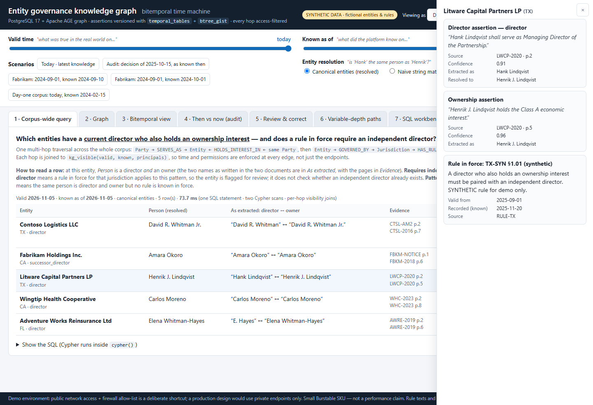

**You should see:** a side panel with, for each fact, the **source document and page**, the **exact sentence**, the **extraction confidence**, the name *as written* in the document, and the person it resolved to. For the rule, it shows when it became valid and when it was recorded.

**Prove it in SQL:** run **Evidence stored with every fact**. The document, page, exact sentence, confidence and extractor version are columns on the assertion row, not computed on the fly.

**Why:** nothing is an answer without a citation. Every assertion row stores `doc_id`, `page`, `excerpt`, `confidence` and `manifest_id` (which extractor version produced it). That is what lets a reviewer, or a customer, verify a result without trusting the system.

### Step 3. See why entity resolution matters

**Do:** under **Entity resolution**, choose **Naive string match**.

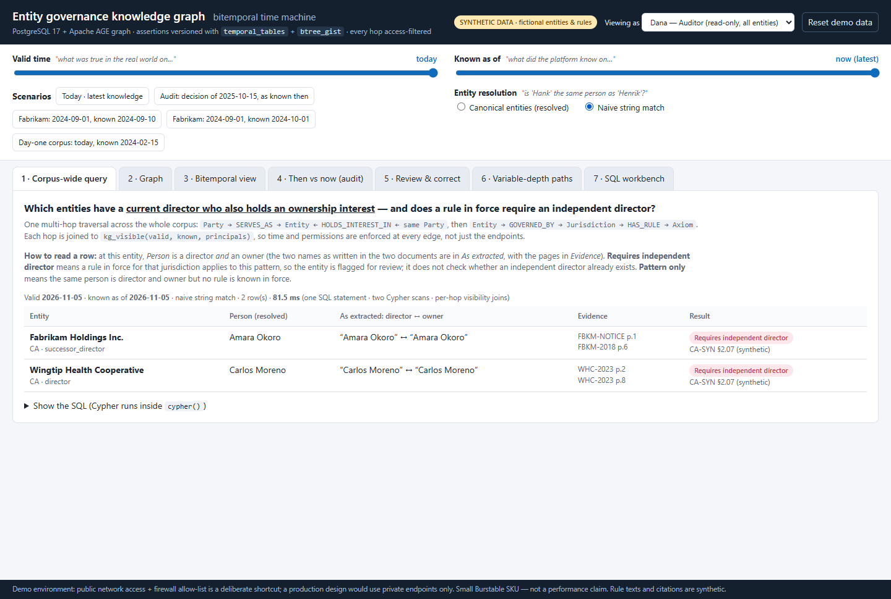

**You should see:** the table shrinks to two rows (Fabrikam and Wingtip). Contoso, Litware and Adventure Works disappear. Switch back to **Canonical entities** and they return.

**Prove it in SQL:** run **Same person, different text**. Each row pairs a director with an owner. Where `same_person` is true but `naive_text_match` is false (Hank/Henrik, E. Hayes, the "Jr." case), a plain text search would have silently missed it.

**Why:** a naive match only accepts the same text in both documents. Litware names its director "Hank Lindqvist" and its owner "Henrik J. Lindqvist"; Adventure Works says "E. Hayes" and "Elena Whitman-Hayes". String matching misses all of these *silently*: no error, just an incomplete report. (Contoso drops out for a different reason: "David R. Whitman" is not the string "David R. Whitman Jr.".)

**Under the hood:** the resolved query joins on the person's identity in the graph (`MATCH (p)-[:SERVES_AS]->(e), (p)-[:HOLDS_INTEREST_IN]->(e)`: the *same* `p`). The naive query joins on two different people whose extracted *surface text* happens to be equal. Each assertion records its resolution method (`exact`, `nickname-variant`, `initial-expansion`, `contextual`), score, and status in the `er_decision` table.

> **Say it (end of Act 2):** *"Nothing is asserted without a citation. And watch what a plain text match does: three of the five answers disappear, with no error. Entity resolution isn't a nicety; it's part of getting the answer right."*

---

## Act 3 · Each person sees only what they may see

*About 2 minutes.*

> **The requirement:** people see only the documents they are entitled to, by region or because a record was shared with them by name. Nobody can infer a hidden record from a visible one.
>
> **Why the business cares:** client confidentiality, and a legal duty to restrict access.
>
> **How it is solved:** every document carries an access list. **One SQL function**, `kg_visible`, checks it, and *every hop* of every query goes through that function, not just the last row. Results never include a count of hidden items, because even a count reveals something.

### Step 4. See permissions enforced

**Do:** switch **Viewing as** to **Marcus (California analyst)**.

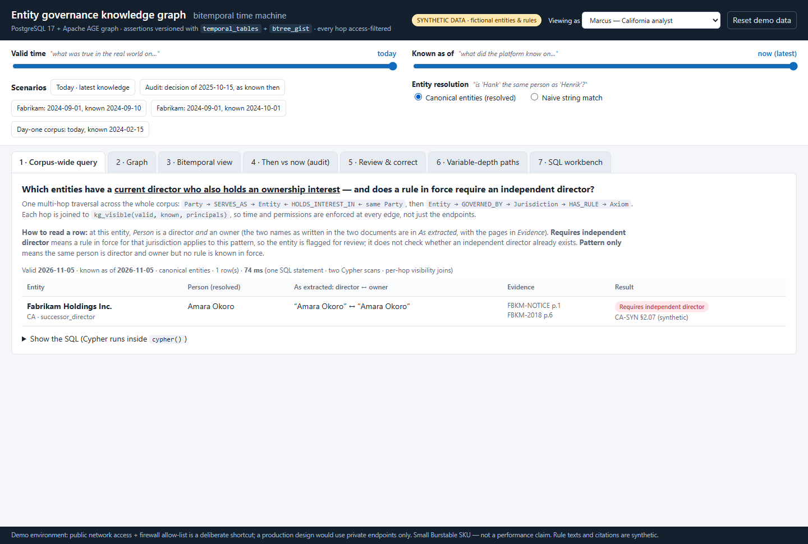

**You should see:** one row, Fabrikam. Wingtip is a California entity, but Marcus does not see it. Now switch to **Priya**: she sees Contoso, Litware, Wingtip and Adventure Works.

**Why:**
- Access is by **group** (region) *and* by **record** (Wingtip was shared to Priya by name). Each document has an access list; a user's principals must overlap it.
- Notice there is **no "4 results hidden" message**. Telling a user how many results exist is itself a leak.
- The check is applied at **every hop**, not just on the final row. Otherwise a visible result could reveal, through its path, a document the user may not read.

**Prove it in SQL:** run **Users, roles and what each may do**: the three users are rows in a table, and `principals` is everything each one holds (groups, a named grant, a role). Then **Who can read which document (the access matrix)**: a document is readable when its `acl` shares an entry with the user's principals, which is why Marcus can't read Wingtip (its only grant is `user:priya`). Then **What each user can read**, and **The full question, as the California analyst**: only Fabrikam, with every hop filtered.

**Under the hood:** `kg_doc.acl` is a text array (`grp:tx`, `user:priya`, `role:auditor`...) and `kg_visible` filters on `d.acl && principals`. The persona's principals come from the server, never the browser.

> **Say it (end of Act 3):** *"Marcus covers California and sees one entity. He doesn't see the Wingtip record, even though it is a California entity, because it was shared with one named person. The check isn't a screen filter; it is inside the query, at every hop."*

---

## Act 4 · Say what we knew on the day of a past decision

*About 5 minutes.*

> **The requirement:** reproduce what the platform concluded on the date of a past decision, and show what changed since.
>
> **Why the business cares:** regulators and clients ask "what did you know when you decided?", not "what is true today?". Sometimes a rule took effect months before you learned of it.
>
> **How it is solved:** every fact carries **two date ranges**: *valid time* (true in the real world) and *system time* (when the platform recorded it). They are PostgreSQL range columns. An extension (`temporal_tables`) archives each old version automatically, and a constraint (`btree_gist`) makes overlapping valid periods impossible. Moving a slider changes two parameters of one function.

### Step 5. Look at the graph

**Do:** switch back to **Dana**, open Tab **2 · Graph**.

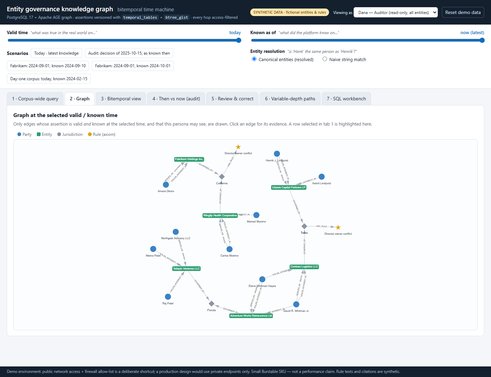

**You should see:** parties (circles), entities (boxes), jurisdictions (diamonds), rules (stars), connected by `SERVES_AS`, `HOLDS_INTEREST_IN`, `GOVERNED_BY` and `HAS_RULE` edges. Click any edge for its evidence. In tab 1, select a row, then return here: its edges are highlighted.

**Why:** the picture is a *projection at the selected times*. Move either slider and the picture changes: edges whose assertion isn't valid and known at that time simply aren't drawn. The graph itself never changed; only which assertions qualify.

### Step 6. See time as rectangles

**Do:** Tab **3 · Bitemporal view**, entity **Contoso Logistics LLC**.

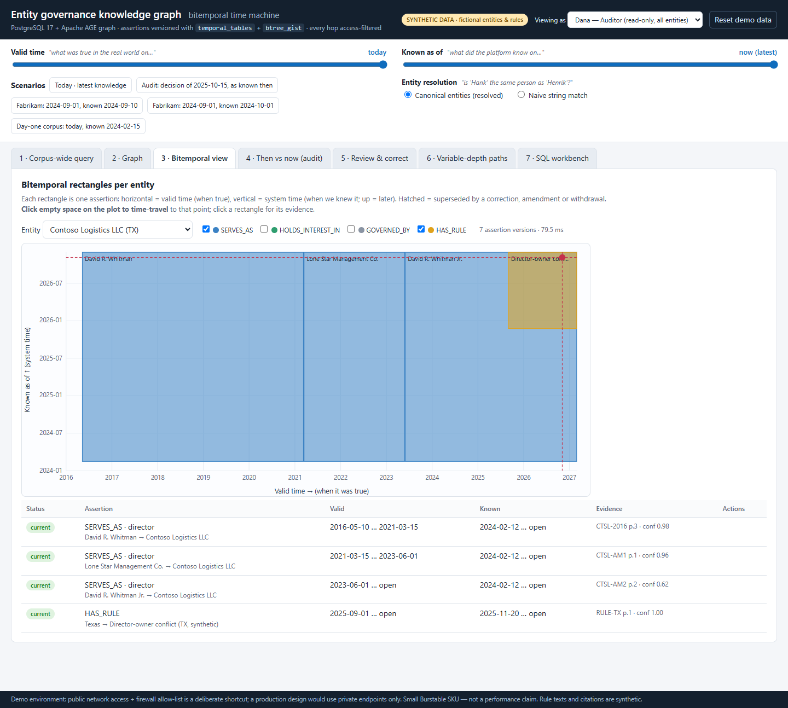

**You should see:** each fact as a rectangle. **Horizontal** is valid time (when it was true); **vertical** is system time (when we knew it; higher is later). The director history tiles left to right: David R. Whitman (2016), Lone Star Management Co. (2021), then from June 2023 **David R. Whitman Jr.**. That last one is the wrong answer you will fix in Step 9. The amber rectangle is the Texas rule: it starts at the *effective* date (September 2025) but its bottom edge is the *recorded* date (November 2025), so it floats above the others.

**Try:** click on empty space in the plot. Both sliders jump to that point in time. Click a rectangle for its evidence.

**Prove it in SQL:** run **One entity's facts, with both clocks**. Each fact has `true_from/true_until` (real-world time) and `known_from/known_until` (when the platform knew it): the rectangles, as rows.

**Why:** this is the single clearest picture of "bitemporal". Each rectangle is a range on two axes. A question such as *"what was true on X as known on Y?"* is simply "which rectangles contain the point (X, Y)?".

### Step 7. Travel back in time

**Do:** Tab 1, click the scenario **Audit: decision of 2025-10-15, as known then**.

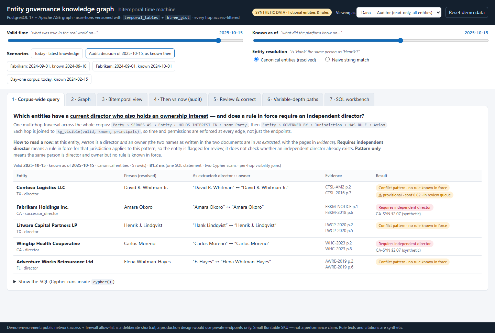

**You should see:** Contoso and Litware are now **Conflict pattern · no rule known in force**, not *requires independent director*.

**Prove it in SQL:** run **Effective date vs recorded date** (the Texas rule: effective 2025-09-01, recorded 2025-11-20), then **Which rules did we know on 2025-10-15?** (only the California rule), then **The full question, as known on 2025-10-15**. Compare it with *today*: Contoso and Litware have gone. Same function, a different date.

**Why:** the Texas rule took effect on 2025-09-01 but the platform only recorded it on 2025-11-20. On 15 October 2025 the platform did not know it. Using only what was known that day, the answer was "pattern, no rule". Today, it is "requires an independent director". **Both are correct** for their own point in time, and the system can reproduce either.

Also try the two **Fabrikam** scenarios. With *known 2024-09-10* Fabrikam is absent; with *known 2024-10-01* it appears. Amara became a director on 2024-08-30, but the notice reached the platform on 2024-09-18, so between those dates reality and knowledge differed.

**Under the hood:** moving the sliders changes two parameters of `kg_visible(valid_at, known_at, principals)`. The filter is `valid @> valid_at AND sys_period @> known_at`. There is no archive restore or log replay: past knowledge lives in `kg_assertion_history`, which `temporal_tables` maintains automatically.

### Step 8. Compare "then" with "now"

**Do:** Tab **4 · Then vs now (audit)**, press **Compare** (with *Known then* 2025-10-15 and *Known now* set to "now").

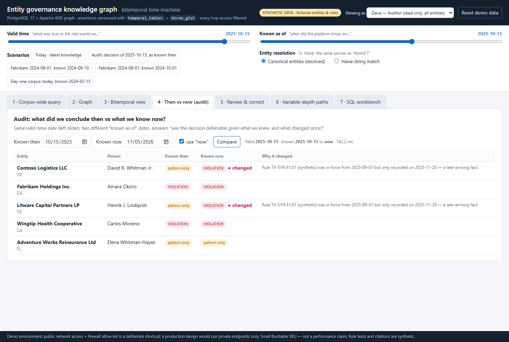

**You should see:** the entities whose status changed, marked **● changed**, with a reason such as *"Rule TX-SYN §1.01 was in force from 2025-09-01 but only recorded on 2025-11-20 — a late-arriving fact."*

**Why:** this answers the audit question *"was the decision defensible given what we knew, and what changed afterwards?"* It runs the same query at two known-as-of dates and diffs the results (in SQL, the two runs you just compared in Step 7).

> **Say it (end of Act 4):** *"The Texas rule took effect on 1 September but we only learned about it on 20 November. On 15 October the honest answer was 'no flag'. Today it is 'flag'. Both are correct, and both can be reproduced. No backup was restored: the platform simply asked the same function a different date."*

---

## Act 5 · Fix errors and record changes without erasing history

*About 5 minutes.*

> **The requirement:** correct extraction errors, record real-world changes, and retract mistakes, always with a trail.
>
> **Why the business cares:** the trail is what makes a correction defensible. You must be able to show what a client was shown last year, and who changed it.
>
> **How it is solved:** three kinds of change, one mechanism. All are archived by the same trigger and recorded in a change log.
>
> | Kind | What happened | Effect on the two clocks |
> |---|---|---|
> | **Correction** (Steps 9–10) | We read it wrong | Valid time unchanged; *knowledge* changes |
> | **Amendment** (Step 11) | The world changed (a term ended) | *Valid* period closes; system time records when we learned it |
> | **Withdrawal** (Step 12) | It was never true; nothing replaces it | Archived; leaves today's answers; stays visible "as known then" |

### Step 9. Correct a mistake, without erasing history

**Do:** switch **Viewing as** to **Priya** (Dana is read-only). Tab **5 · Review & correct**.

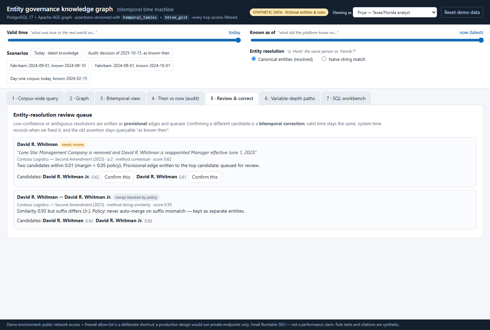

**You should see:** two cards.

1. **"David R. Whitman"** needs review. The 2023 amendment says *"David R. Whitman is reappointed Manager"*, and there are two people with that name: the founder and his son (Jr.). The extractor scored them 0.62 and 0.61. Because the margin was below the 0.05 policy, it wrote a **provisional** edge to the top candidate (the son) and queued it. That produced a false conflict at Contoso (the son is an owner).
2. **A merge blocked by policy.** The two names are 93% similar but differ by a suffix ("Jr."), so the rule is *never auto-merge on suffix mismatch*. Two real people are kept apart. A wrongly merged identity is worse than a missed one.

**Do:** next to **David R. Whitman** (the founder), click **Confirm this**.

**You should see:** a message that the old assertion was archived (still visible "as known then") and a new one written.

### Step 10. See what the correction did and did not change

**Do:** Tab **3 · Bitemporal view**, entity Contoso.

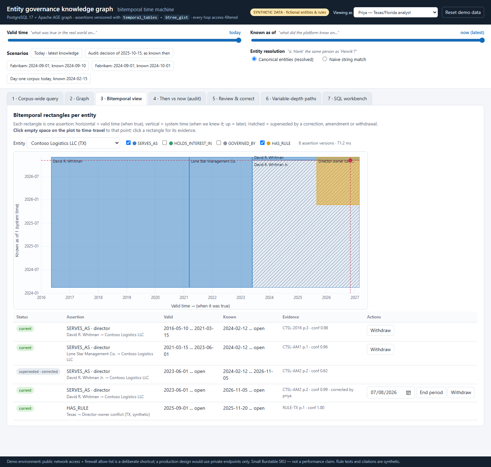

**You should see:** the son's rectangle is now **hatched** (superseded, not deleted) and a new rectangle for the founder sits on top, labelled *corrected by priya*. In the table, the old row has a *Known* range that **ends** at the correction date; the new row's *Known* range **starts** there. The *Valid* range is identical on both rows (2023-06-01 onward).

**Do:** Tab 1 with *Today*: Contoso is gone (the founder isn't an owner, so the false alarm is resolved). Then use the audit scenario and **Compare** again:

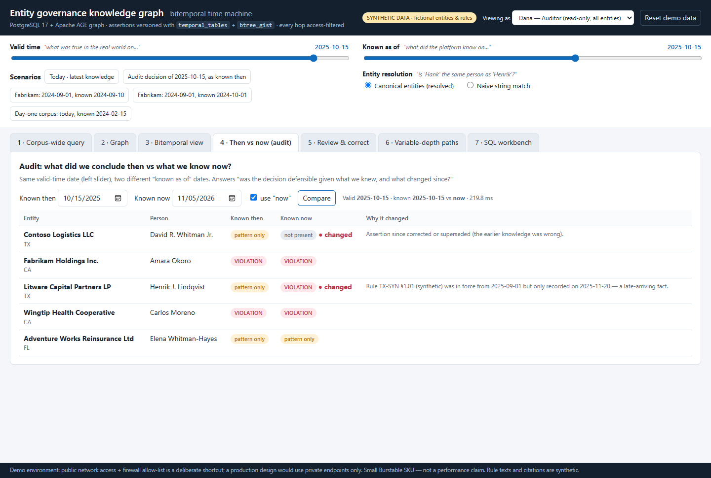

Contoso now reads *pattern only → not present*, with the reason *"Assertion since corrected or superseded."*

**Prove it in SQL:** run **Everything that has been changed, and by whom**. You'll see the log entry (`corrected`, by priya) next to the archived version of the wrong assertion (known until the moment you clicked) and the new one. Then run **The archive table maintained by temporal_tables**: the old row is there, and no application code put it there.

**Why:** the real-world fact (the founder has been director since June 2023) never changed. Only our knowledge did, and the system recorded when and by whom. The earlier, wrong belief remains in the history if an auditor asks what was shown at the time. **A correction is an addition to the record, not an edit of it.**

**Under the hood:** one database transaction (see [section 5.5](#55-the-correction-transaction)):
`DELETE` the wrong assertion → `temporal_tables` copies it to history with its system period closed; `INSERT` the right assertion with the **same valid period**; update the review record.

### Step 11. End a period: the world changed

**Do:** switch **Viewing as** to **Marcus**, open Tab **3 · Bitemporal view**, entity **Fabrikam Holdings Inc.**

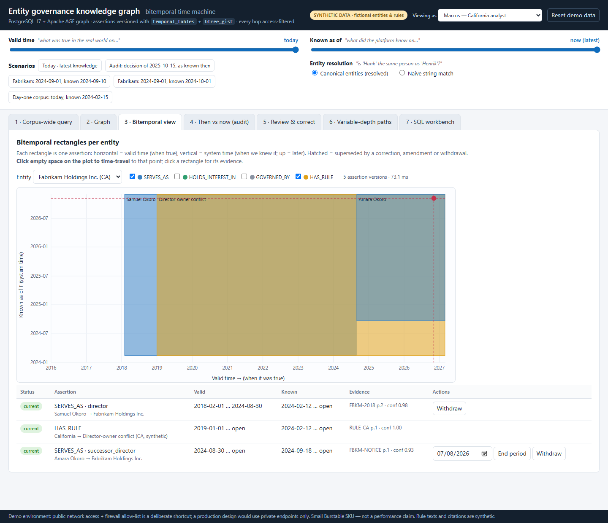

**You should see:** an **Actions** column. Analysts (not the read-only auditor) get **End period** and **Withdraw** on role and ownership assertions. Amara's role is open-ended (valid from 2024-08-30, no end), so it has an end-date box.

**Do:** click **End period** (the date is pre-filled; any date after the start works).

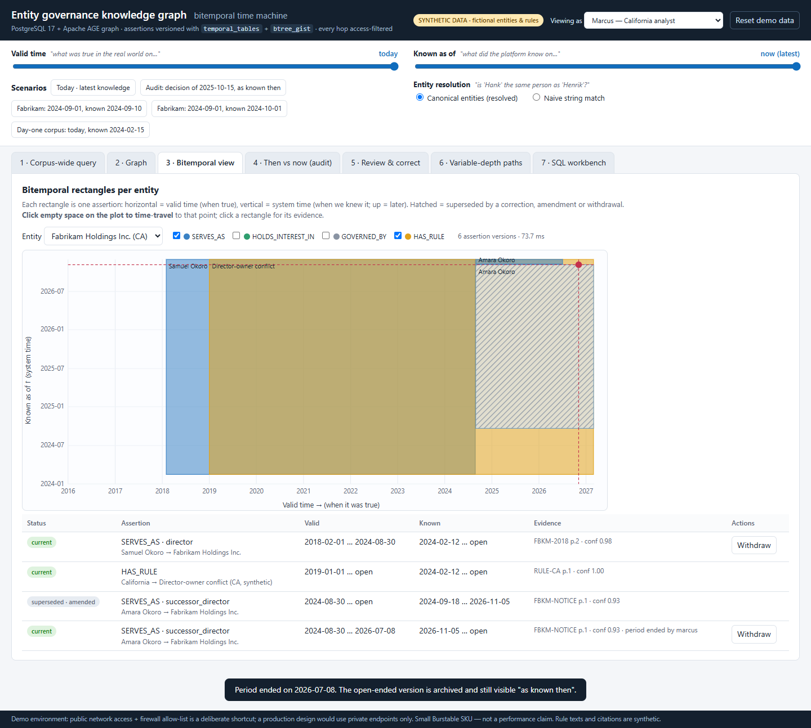

**You should see:** the current row now has a closed valid period, and above it a row tagged **superseded · amended**. That is the previous, open-ended version. Its *Known* range stops at the moment you clicked, and the new row's *Known* range starts there.

**Do:** Tab **4 · Then vs now**, press **Compare**.

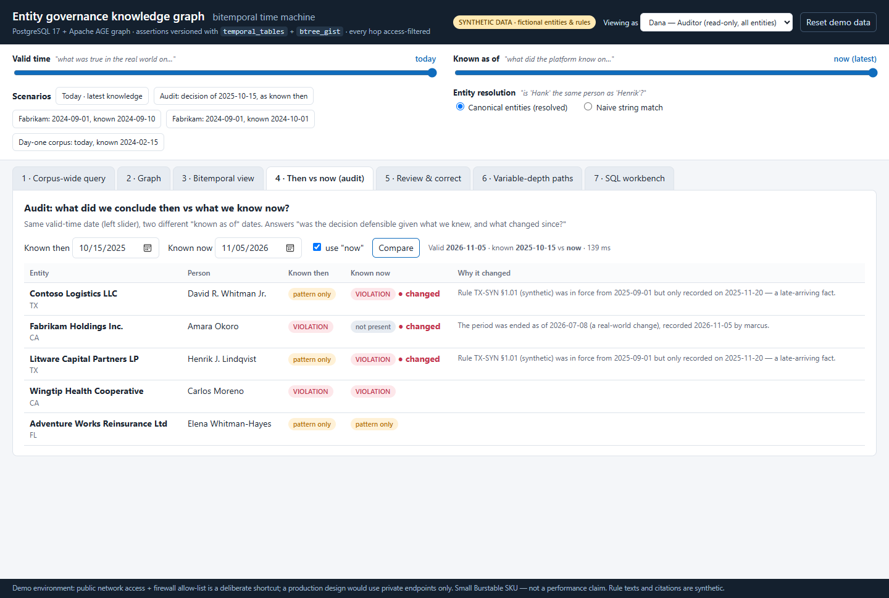

**You should see:** Fabrikam moves from *requires independent director* to *not present*, with the reason *"The period was ended as of … (a real-world change), recorded … by marcus."* The two Texas rows still carry the late-arriving-rule reason.

**Prove it in SQL:** rerun **Everything that has been changed, and by whom**. A new `amended` entry appears; the archived row is the open-ended version (`true_until` empty), and the current row has the end date.

**Why:** this is the other half of the story. In Step 10 a correction left **valid time alone** and changed only what we knew. Here the **world changed**: the term ended, so *valid time* moves, and the *system time* records when we learned it. Same two columns, two different kinds of change, and the audit view tells them apart.

**Under the hood:** one `UPDATE kg_assertion SET valid = tstzrange(lower(valid), <end>)`. The `temporal_tables` trigger copies the old row (still open-ended) into history with its system period closed. The change is also written to an append-only `kg_change_log` (who, what, when), which is how the diff explains each difference. Guards: only role and ownership assertions can be changed; the period must be open-ended and the end date after its start; the auditor gets HTTP 403; a user who can't read the document gets 404.

### Step 12. Withdraw a fact that was a mistake

**Do:** switch to **Priya**, Tab 3, entity **Wingtip Health Cooperative**, tick **HOLDS_INTEREST_IN**, and click **Withdraw** on Carlos Moreno's ownership. Confirm the prompt.

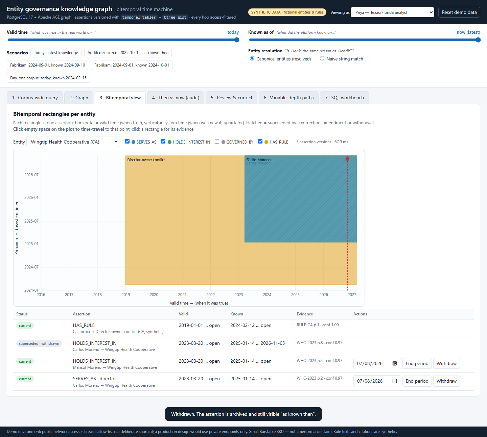

**You should see:** the row is tagged **superseded · withdrawn**, and nothing replaces it. In Tab 1 (*Today*), Wingtip has left the results, because Carlos no longer holds an interest. Set *Known as of* to any date before the withdrawal and Wingtip is back.

**Prove it in SQL:** rerun **Everything that has been changed, and by whom**. A `withdrawn` entry appears with one archived row and no replacement. Then run **The full question: today, as an auditor**: Wingtip has gone.

**Why:** some facts were never true (a misread clause), not a correction to a different value. A retraction removes the fact from today's answers without destroying it: the audit view can still show what the platform believed and showed before.

**Under the hood:** a `DELETE`. The trigger archives the row into `kg_assertion_history`, and `kg_change_log` records who withdrew it. The Tab 4 reason reads *"Assertion since withdrawn by priya … (recorded as a mistake, no replacement)."*

> **Say it (end of Act 5):** *"Look at what the audit view says: 'a real-world change' for the term that ended, 'corrected' for the misread name, 'withdrawn' for the mistake. Nothing was overwritten; the old answer is one query away. And no application code wrote the archive: PostgreSQL did, through a trigger."*

---

## Act 6 · Know the limits before committing

*About 4 minutes.*

> **The requirement:** be told, plainly, where this breaks or hasn't been proven.
>
> **Why the business cares:** the risks that matter are the quiet ones.
>
> **What this act shows:** three things you should know before relying on any of this: a half-loaded corpus looks complete (Step 14), deeper traversals cost more than they look (Step 13), and the machinery is ordinary PostgreSQL you can inspect (Step 15).

### Step 13. Variable-depth paths, with time and access on every hop

**Do:** switch to **Dana**, Tab **6 · Variable-depth paths**.

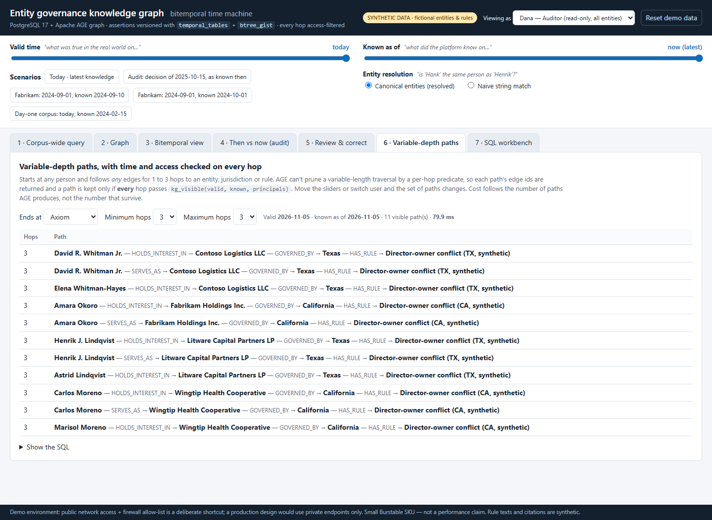

**You should see:** every path of exactly three hops from a person to a rule, for example *person → serves as → entity → governed by → jurisdiction → has rule → rule*. Change **Minimum hops** and **Maximum hops**, or **Ends at**, and the set changes. Switch to Marcus and only California paths remain; move the sliders and the paths follow the dates.

**Prove it in SQL:** run **Three-hop paths, each hop checked afterwards**. It returns a count of visible paths. In the query, change `grp:ca` to `role:auditor`, or the dates, and run it again: the count follows.

**Why:** Step 1 uses a fixed pattern. This view follows *any* edges up to three hops. Apache AGE 1.7 has no per-hop predicate for variable-length paths, so a traversal can't be pruned by time or access *while it runs*. Instead the traversal returns each path's edge ids and a path is kept only if **every** hop passes `kg_visible`. It is correct, but it filters after traversal, so cost follows the number of paths AGE produces, not the number that survive. Open **Show the SQL**; [section 5.9](#59-performance-notes-measured-a-small-server) has timings (about 2 s for 61,000 paths on a small server).

The view deliberately shows only the visible paths and their count, never how many were hidden.

### Step 14. A half-loaded corpus looks complete

**Do:** switch to **Dana**, Tab **1 · Corpus-wide query**, click the scenario **Day-one corpus: today, known 2024-02-15**.

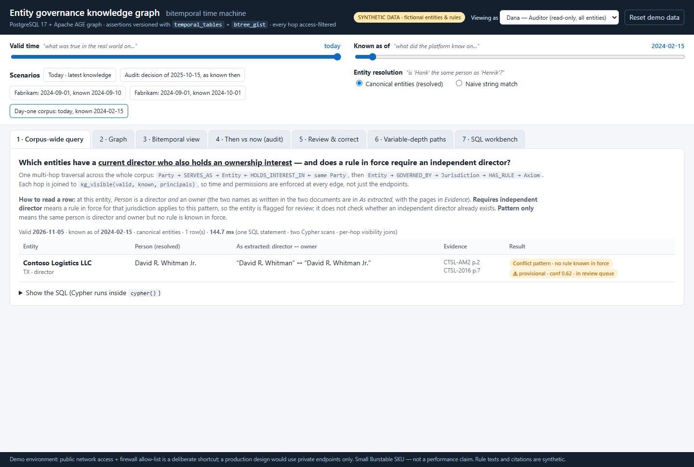

**You should see:** one row (Contoso, as *pattern only*) where the full corpus gives five.

**Prove it in SQL:** run **The full question, as known on 2025-10-15** and change both dates to `'2024-02-15'`. Same function, same query, a much smaller answer, and no error.

**Why:** this shows today's world, but only as known on 2024-02-15, when only the first documents had been loaded. Nothing errored. The answer is **confident and incomplete**. This is what a corpus-wide query looks like before all the existing documents are ingested, and it is why "corpus-wide" is only as good as how much of the corpus is loaded. (The demo simulates a partial load with the *known as of* slider; it doesn't run a real bulk load.)

### Step 15. Look under the hood: it is just PostgreSQL

**Do:** tab **7 · SQL workbench**, then run these four, in order:

1. **Prove the trigger: change a fact, watch history appear, roll back.** `kg_assertion_history` is empty until something changes, so this proves the trigger *live*. It runs a real `UPDATE` on one fact, then shows the archive table: the **old** version is there, its "known until" closed at that moment, while the live row holds the new value and a fresh "known from". Then it rolls everything back, so no data changes. No history code appears anywhere in the `UPDATE`: PostgreSQL's trigger wrote it. (This is the one deliberate write in the workbench, and it is always rolled back. To keep a real history row, do Step 9, 11 or 12 and run **The archive table maintained by temporal_tables**.)
2. **The constraint and trigger that do the work**: an exclusion constraint that forbids overlapping valid periods for one edge, and the trigger that archives every old version. Both are read from the PostgreSQL catalog.
3. **The one function that applies time and access**: the whole rule is `valid @> valid_at AND sys_period @> known_at AND acl && principals`.
4. **What PostgreSQL does for a visibility check**: an ordinary query plan. Ranges and arrays are indexed and planned like any other data.

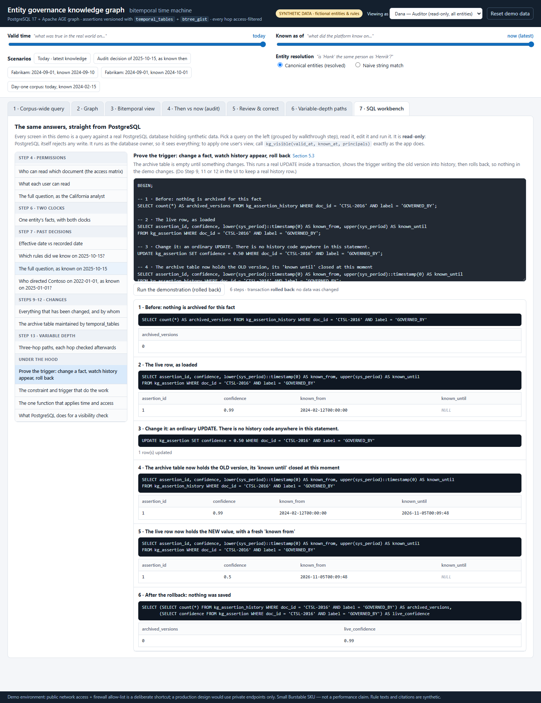

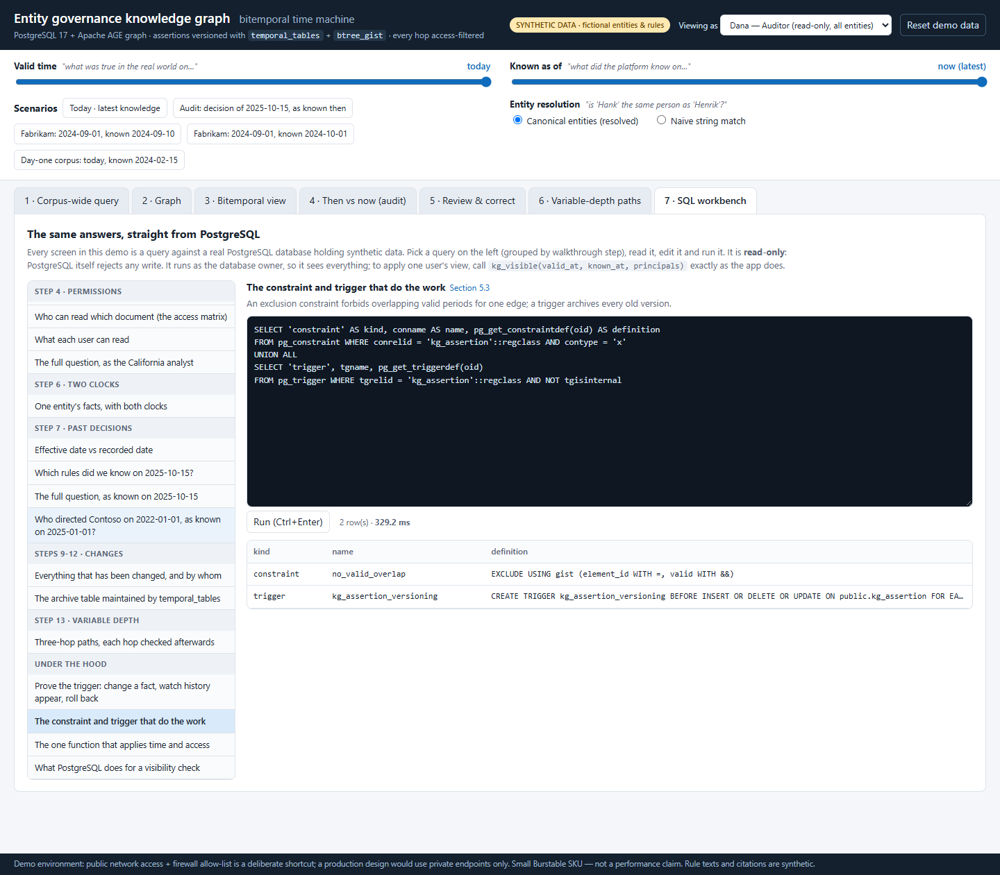

**Why:** nothing here is a black box. The time model is two columns, one constraint, one trigger and one function, all inspectable and all standard PostgreSQL.

**What isn't proven.** Scale beyond about 100,000 edges, real extraction quality, vertex-attribute versioning and a repository layer. [Section 9](#9-what-this-demo-covers-and-what-it-does-not) lists every gap.

> **Say it (end of Act 6):** *"This proves the model: two clocks, access on every hop, evidence on every fact, and corrections that add to the record. It doesn't prove scale or extraction quality, and a half-loaded corpus will look complete; that's what the proof of concept is for."*
>
> **Closing line:** *"One PostgreSQL database; documents become facts, facts carry two dates, every answer carries its evidence, and every change adds to the record. And everything you saw is a query you can run yourself."*

### Step 16. Reset and explore

Click **Reset demo data**. Then try the same actions as the other users. As **Marcus**, the review queue is empty (Contoso's documents aren't visible to him). As **Dana**, the queue is visible but has no **Confirm this**, **End period** or **Withdraw** buttons, and the server answers HTTP 403 if you call those endpoints directly. Then do the [exercises](#7-exercises).

---

## 5. How it works: technical reference

### 5.1 Architecture

```
  Browser (vanilla JS, vis-network)            Local machine
        │  /api/*  (JSON)
  FastAPI + psycopg pool  ──────────────────►  Azure Database for PostgreSQL Flexible Server (PG 17)
                                                 ├─ Apache AGE   : graph "entity_graph" (structure only)
                                                 ├─ kg_assertion : facts per edge, valid × system time
                                                 ├─ kg_assertion_history (maintained by temporal_tables)
                                                 ├─ kg_doc       : documents + access lists
                                                 ├─ party_registry, er_decision : entity resolution
                                                 ├─ kg_change_log : who corrected, amended or withdrew what
                                                 └─ kg_visible() : the single time + access filter
```

| Extension | Role |
|---|---|
| `age` 1.7 | Property graph with openCypher inside SQL. Must be in `shared_preload_libraries`. |
| `temporal_tables` 1.2 | Row-versioning trigger: copies the old row into a history table and stamps `sys_period`. |
| `btree_gist` | Lets a GiST exclusion constraint combine `=` on a scalar with `&&` on a range. |
| `fuzzystrmatch`, `pg_trgm` | Name-similarity primitives for entity resolution. |

### 5.2 Data model

**Graph (`entity_graph`)**

| Vertex | Properties |
|---|---|
| `Party` | `key`, `name`, `kind` (person/org) |
| `Entity` | `key`, `name`, `jurisdiction` |
| `Jurisdiction` | `key`, `name` |
| `Axiom` | `key`, `name`, `cite`, `text` (the rule) |

Edges: `SERVES_AS` (Party→Entity), `HOLDS_INTEREST_IN` (Party→Entity), `GOVERNED_BY` (Entity→Jurisdiction), `HAS_RULE` (Jurisdiction→Axiom). Edges carry no time.

**Facts (`kg_assertion`)**: abbreviated from `schema.sql`:

```sql
CREATE TABLE kg_assertion (
    assertion_id bigserial PRIMARY KEY,
    element_id   bigint NOT NULL,          -- the AGE edge id this fact is about
    label        text NOT NULL,            -- edge type
    props        jsonb NOT NULL,           -- role, surface text, corrected_by ...
    doc_id       text NOT NULL REFERENCES kg_doc(doc_id),
    page int, excerpt text, confidence numeric(4,3), manifest_id text,
    valid        tstzrange NOT NULL,                                   -- real-world period
    sys_period   tstzrange NOT NULL DEFAULT tstzrange(current_timestamp, NULL), -- knowledge period
    CONSTRAINT no_valid_overlap EXCLUDE USING gist (element_id WITH =, valid WITH &&)
);
CREATE TABLE kg_assertion_history (LIKE kg_assertion);
CREATE TRIGGER kg_assertion_versioning BEFORE INSERT OR UPDATE OR DELETE ON kg_assertion
    FOR EACH ROW EXECUTE PROCEDURE versioning('sys_period', 'kg_assertion_history', true);
```

Three supporting tables: `kg_doc` (each document, with its access list), `kg_user` (the users, their principals and whether they may correct; the app reads its personas from here) and `kg_change_log` (append-only: which assertion was `corrected`, `amended` or `withdrawn`, by whom, when and why). The assertion tables record **what** changed through history; the change log records **who and why**, and lets the audit diff explain each difference.

### 5.3 How bitemporal versioning actually works

- `valid` is **data you supply** from the document ("effective March 15, 2021").
- `sys_period` is **managed by `temporal_tables`**: on `INSERT` it starts at the transaction time with an open end; on `UPDATE`/`DELETE` the trigger copies the *old* row into `kg_assertion_history` with its `sys_period` closed at that moment, then applies the change.
- Current rows live in `kg_assertion`; superseded rows live in `kg_assertion_history`. The view `kg_assertion_all` unions both with an `is_current` flag.
- `EXCLUDE USING gist (element_id WITH =, valid WITH &&)` makes it **impossible for one edge to have two overlapping real-world periods**. Try it in [section 6](#6-try-it-yourself-in-sql).
- **Seeding with history:** `temporal_tables` exposes `set_system_time(ts)`. The seed script calls it before each dated batch, so the history reads as if each fact was learned on its real day. This also demonstrates how a historical backfill can reconstruct system time.

### 5.4 The visibility function: time and access in one place

```sql
CREATE FUNCTION kg_visible(v timestamptz, s timestamptz, principals text[]) RETURNS TABLE (...) AS $$
    SELECT a.* FROM kg_assertion_all a JOIN kg_doc d ON d.doc_id = a.doc_id
    WHERE a.valid @> v AND a.sys_period @> s AND d.acl && principals
$$ LANGUAGE sql STABLE;
```

This is the **only** place that applies time and permissions. Every query joins to it, so a rule cannot be forgotten in one code path. It is also why the same function powers the query, the graph, and the audit diff.

### 5.5 The correction transaction

```sql
BEGIN;
  -- (1) find or create the graph edge for the correct person (AGE; structure only)
  -- (2) archive the wrong assertion: temporal_tables closes its sys_period into history
  DELETE FROM kg_assertion WHERE assertion_id = :old;
  -- (3) write the right assertion with the SAME valid period
  INSERT INTO kg_assertion (element_id, label, props, doc_id, page, excerpt, confidence, manifest_id, valid)
  VALUES (:new_edge, :label, :props || '{"corrected_by": "priya"}', :doc, :page, :excerpt, 0.99, 'sme-correction', :same_valid);
  -- (4) record the decision (who, when, what replaced what)
  UPDATE er_decision SET status='corrected', prior_assertion_id=:old, decided_by=:user, decided_at=now() ...;
COMMIT;
```

The server also checks that the user is allowed to correct (read-only auditors get 403), that the user can read the document (otherwise 404, to avoid leaking existence), and locks the review row (`FOR UPDATE`) so two people can't resolve it twice (second attempt gets 409).

**Amendment and withdrawal use the same machinery.** An *amendment* is a single `UPDATE kg_assertion SET valid = tstzrange(lower(valid), :end)`: the trigger archives the previous, open-ended version and the new row's system period starts now, so valid time moves and system time records when we learned it. A *withdrawal* is a single `DELETE`: the trigger archives the row and nothing replaces it. Both write a row to `kg_change_log` (`corrected`, `amended` or `withdrawn`, with actor, note and time), which the audit diff reads to explain *why* a result changed. Only role and ownership assertions can be changed this way; shared rule assertions cannot.

### 5.6 Anatomy of the flagship query

1. **Cypher scan A** returns `(entity, person, edge1, edge2)` for *a person who serves as director of an entity and holds an interest in the same entity*.
2. **Cypher scan B** returns `(entity, edge_governed_by, edge_has_rule, rule text)`.
3. Join scan A's `edge1` and `edge2` to `kg_visible(...)`: each hop must be *valid, known and permitted*.
4. Join scan B's two edges to `kg_visible(...)` the same way.
5. Left-join the rule to the pair: a pair without a visible rule becomes "pattern only".

The **resolved/naive toggle** only changes scan A's pattern: the same `p` on both edges (canonical identity), versus two different parties plus a surface-text equality.

### 5.7 Entity resolution policy (illustrative)

| Situation | Behaviour |
|---|---|
| Exact name or registered alias | Auto-resolve, score 1.0 |
| Nickname variant or initial expansion with a single candidate | Auto-resolve with score and method recorded (e.g. 0.91, 0.88) |
| Two candidates within a 0.05 margin | **Provisional** edge to the top candidate + review queue |
| High similarity but conflicting suffix (Jr./Sr.) | **Never merge**; recorded as `blocked` |

Thresholds are illustrative; in a real deployment they come from a labelled evaluation set.

### 5.8 API reference

| Endpoint | Purpose |
|---|---|
| `GET /api/meta?persona=` | Personas, visible entities, server time |
| `GET /api/flagship?persona=&valid=&known=&resolve=` | The corpus-wide query (returns rows, timing, and the SQL) |
| `GET /api/graph?persona=&valid=&known=` | Edges visible at the selected times |
| `GET /api/timeline/{entity}?persona=` | All assertion versions (current and superseded) for the rectangles |
| `GET /api/diff?persona=&valid=&known_a=&known_b=` | Two flagship runs diffed |
| `GET /api/review?persona=` | Non-automatic resolutions |
| `POST /api/review/{id}/resolve` | Correction transaction |
| `POST /api/assertions/{id}/end` | Amendment: close an open-ended valid period (`valid_to`) |
| `POST /api/assertions/{id}/withdraw` | Retraction: archive an assertion with no replacement |
| `GET /api/paths?persona=&valid=&known=&end=&min_hops=&max_hops=` | Variable-depth paths (1–3 hops), every hop checked by `kg_visible` after traversal |
| `POST /api/reset` | Drop and re-seed |

`valid=now` / `known=now` are accepted and resolve to the **database's** clock, not the app's: `sys_period` is stamped by the database, so an app clock that runs slightly behind would hide a change made a moment earlier. In the UI, a slider at its maximum means *now*, so later changes remain visible.

### 5.9 Performance notes (measured; a small server)

- Main query: about **0.1 s** end to end on ~28 assertions (this includes a ~75 ms internet round trip).
- A separate probe at about **104k edges / 81k current + 24k history assertions** on the same small tier returned the main query in about **0.7 s** (1,000 result rows). The **as-of variant** (valid 2019-06, known 2023-06, which reads only history rows) took about **0.3 s**.
- Variable-length traversal with the per-hop check applied **after** traversal (Tab 6; section 6): about **2 s** for 61,000 two-hop or three-hop paths, against about 0.4–0.6 s for the raw traversal with no visibility check. Its cost followed the number of paths AGE produced, **not** the number kept: with a user who could see about 20% of the data it took the same time (about 2 s) and returned 7,000 paths.
- **Selective access lists** (ten access groups, a user holding two of them): the main corpus-wide query took about **0.45 s**, against about **0.63 s** with no filtering. In that probe the generated conflicts all fell inside the two groups chosen, so the result size was unchanged; read it as the cost of the access join, not as a general result.
- **A planner trap worth knowing:** wrapping the visibility function in a materialised CTE made the planner assume 41 rows and nested-loop over 8,101, discarding about 810,000 rows. The query took **3.8 s**. Joining `kg_visible` once per hop, indexing `element_id`, and hash-joining the rule set (not a per-row `LATERAL`) brought it to about **0.15 s** at the same data size. Always check hop joins with `EXPLAIN ANALYZE`.
- These are *not* sizing claims. A proper large-scale test is still required. You can reproduce the probe with `.\.venv\Scripts\python scale_probe.py 20000` (it uses a separate `<database>_scale` database; drop it afterwards).

---

## 6. Try it yourself in SQL

You don't need a separate client: the **7 · SQL workbench** tab in the UI runs read-only queries against the same database, with a preset for each walkthrough step (33 in all), and every preset is editable. To use your own client instead (psql, the VS Code PostgreSQL extension, Azure Data Studio), connect with the values in `.env`. The examples below also run in either place.

In your own client, each session needs:

```sql
SET search_path = public, ag_catalog;
```

**Who was director of Contoso on 2022-01-01, as known on 2025-01-01?**

```sql
SELECT agstr(person) AS director, v.doc_id, v.valid, v.sys_period
FROM cypher('entity_graph', $$
       MATCH (p:Party)-[r:SERVES_AS]->(e:Entity {key:'E1'}) RETURN p.name, id(r) $$)
     AS (person agtype, rid agtype)
JOIN kg_visible('2022-01-01', '2025-01-01', ARRAY['role:auditor']) v
  ON v.element_id = (rid::text)::bigint;
-- → Lone Star Management Co.   (change the first date to 2024-01-01 → David R. Whitman Jr.)
```

**Variable-length traversal with a per-hop time and access check.** AGE can't prune by a per-hop predicate, but it can return each path's edge ids. Discard any path that has a hop `kg_visible` doesn't return:

```sql
WITH paths AS (
  SELECT agstr(an) AS start_name, agstr(bn) AS end_name, ids::text::jsonb AS ids
  FROM cypher('entity_graph', $$
         MATCH path=(a:Party)-[*1..3]->(b:Jurisdiction)
         RETURN a.name, b.name, [x IN relationships(path) | id(x)] $$)
       AS (an agtype, bn agtype, ids agtype)
),
vis AS MATERIALIZED (
  SELECT element_id FROM kg_visible('2025-10-15', '2025-10-15', ARRAY['grp:all','role:auditor'])
)
SELECT start_name, end_name, jsonb_array_length(ids) AS hops
FROM paths p
WHERE NOT EXISTS (SELECT 1 FROM jsonb_array_elements_text(p.ids) e
                  WHERE e::bigint NOT IN (SELECT element_id FROM vis));
-- Change '*1..3' to '*3..3' and the end label to Axiom: with known = 2025-10-15 only the California rule
-- paths appear; with known = now the Texas paths appear as well.
```

Because this filters *after* traversal, its cost follows the number of paths AGE produces, not the number that survive (see [5.9](#59-performance-notes-measured-a-small-server)).

**When was each rule in force versus when did we learn it?**

```sql
SELECT doc_id, lower(valid) AS effective, lower(sys_period) AS recorded
FROM kg_assertion WHERE label = 'HAS_RULE' ORDER BY 1;
-- RULE-CA: 2019-01-01 / 2024-02-12      RULE-TX: 2025-09-01 / 2025-11-20
```

**Prove the exclusion constraint** (this should fail; wrap it in `BEGIN; ... ROLLBACK;`):

```sql
INSERT INTO kg_assertion (element_id, label, doc_id, valid)
SELECT element_id, 'SERVES_AS', 'CTSL-2016', tstzrange('2020-01-01','2021-01-01')
FROM kg_assertion WHERE doc_id = 'CTSL-2016' AND label = 'SERVES_AS' LIMIT 1;
-- ERROR: conflicting key value violates exclusion constraint "no_valid_overlap"
```

**Watch `temporal_tables` work** (inside a transaction you roll back):

```sql
BEGIN;
UPDATE kg_assertion SET confidence = 0.5 WHERE doc_id = 'CTSL-2016' AND label = 'GOVERNED_BY';
SELECT assertion_id, confidence, sys_period FROM kg_assertion_history WHERE doc_id = 'CTSL-2016' AND label = 'GOVERNED_BY';
ROLLBACK;
```

**See everything superseded after you did Step 9:**

```sql
SELECT assertion_id, label, valid, sys_period FROM kg_assertion_history ORDER BY upper(sys_period);
```

---

## 7. Exercises

After editing `seed.py`, re-seed with `.\.venv\Scripts\python bootstrap.py` (the running app caches the old seed module, so the **Reset demo data** button only picks up edits after you restart `.\run.ps1`). Then refresh the browser.

1. **Learn the rule on time.** In `seed.py`, change the batch date of the Texas rule from `2025-11-20` to `2025-09-01` (the platform learned it the day it took effect) and Reset. Re-run the audit scenario from Step 7. What changed, and why?
2. **Add a late-arriving fact.** Add an assertion to `BATCHES` in `seed.py` with a *valid* start in 2022 but a *system* batch date earlier this year. In Tab 3, where does its rectangle sit?
3. **Change the access model.** Change the Wingtip document's `acl` in `seed.py` to `["grp:ca","role:auditor"]` and Reset. Who can now see Wingtip? Who no longer can? (Dana is unaffected.)
4. **Pre-empt the correction.** In `seed.py`, change the second Contoso amendment's director assertion from `"P2"` to `"P1"` and Reset. Tab 1 should no longer list Contoso. That is the outcome Step 9 reaches by correction.
5. **Cross-check with SQL.** Reproduce the Tab 1 answer for `dana` at `2025-10-15`/`2025-10-15` using only the queries in section 6 as building blocks.
6. **Profile it.** Run `EXPLAIN (ANALYZE) ` on the SQL shown under *Show the SQL* and find the per-hop joins to `kg_visible`.

---

## 8. Limits, trade-offs and what changes in production

**What this demo does not cover:** document extraction, AI agents, an API gateway, an event stream, or real identity (users here are fixed personas chosen in the UI). It demonstrates the **data model, time semantics, access control and correction workflow**.

**Honest limits and findings**

- **Public network access with a firewall allow-list** is a demo shortcut. A production deployment should use private endpoints and Microsoft Entra authentication.
- **Variable-length paths and per-hop access:** Apache AGE 1.7 has no per-hop predicate over variable-length paths (`ALL(x IN relationships(path) WHERE ...)` is a syntax error), so a traversal can't be pruned by time or access *while it runs*. Two workable patterns exist: (1) fixed-length patterns with each hop's edge id joined to `kg_visible` (Tab 1), and (2) a variable-length traversal that returns `[x IN relationships(path) | id(x)]` and discards any path with a hop that isn't visible (Tab 6; [section 6](#6-try-it-yourself-in-sql)). Pattern 2 is correct, but it filters *after* traversal, so cost follows the unfiltered path count (about 2 s for 61,000 paths on a small server, regardless of how selective the access filter is). Dense hubs and deep traversals (beyond three hops) were not tested and belong in any proof of concept. Alternation in relationship types (`[:A|B*1..2]`) and property access inside a list comprehension (`[x IN nodes(path) | x.name]`) are also unsupported.
- **Clock source:** `sys_period` is stamped by the database, so "now" in a query must come from the database too. An application clock a moment behind would treat a change made seconds ago as "not yet known".
- **Managed-service constraints:** `LOAD 'age'` is rejected; AGE must be listed in both `azure.extensions` and `shared_preload_libraries` (restart required); each session needs `ag_catalog` on `search_path`.
- **Scale:** the data set is tiny. Treat the numbers in 5.9 as shape, not capacity.
- **Resolution thresholds** are illustrative.
- **Record-level sharing** (Wingtip) is modelled as a document-level access-list entry; production would derive it from the source system of record.

**Design alternatives considered, and why this shape**

| Alternative | Why not here |
|---|---|
| Put `valid_from/valid_to` as properties on graph edges | AGE stores properties as untyped `agtype`: no range type, no exclusion constraint, no native temporal versioning. |
| Delete and re-create edges when facts change | Loses history and breaks "as known then". Edges are append-only here. |
| Event sourcing and replay to answer "as of" questions | Rebuilding state by replay is heavy for ad-hoc queries; the history table answers them with a range predicate. An event log is still useful as an *audit copy*. |
| Separate temporal database | Splits transactions across systems. Here a correction is a single ACID transaction over graph, assertions and review state. |
| Application-level access filtering | Easy to forget on one path. A single SQL function joined at every hop can't be skipped by a new endpoint. |

---

## 9. What this demo covers, and what it does not

**Scope.** This demo is deliberately about two things only: **Apache AGE on Azure Database for PostgreSQL** as the graph engine, and the **bitemporal model** on top of it (valid time, system time, access control and corrections). Everything else in a full platform (extraction, search, agents, gateway, integrations, networking, recovery) is outside it by design and is not listed as a gap. Use this table to be precise about what has been shown *within that scope*.

**Legend:** ✅ demonstrated · ◐ partly demonstrated · ❌ in scope but not yet demonstrated

### The data model, time and access

| Requirement or theme | Status | Where, and any caveat |
|---|---|---|
| Corpus-wide multi-hop questions across all documents | ✅ | [Step 1](#step-1-ask-a-corpus-wide-multi-hop-question) (fixed depth) and [Step 13](#step-13-variable-depth-paths-with-time-and-access-on-every-hop) (variable depth, up to three hops, every hop checked after traversal). AGE 1.7 can't prune by a per-hop predicate while traversing; see [section 8](#8-limits-trade-offs-and-what-changes-in-production). |
| Two time axes: when a fact was true, and when the platform knew it | ✅ | Sliders; [Step 6](#step-6-see-time-as-rectangles) |
| Historical decisions queryable against the rules in force at the time | ✅ | [Steps 7–8](#step-7-travel-back-in-time) |
| Distinguishing "the rule changed" from "we were wrong" | ✅ | Late-arriving rule ([Step 7](#step-7-travel-back-in-time)), correction ([Step 10](#step-10-see-what-the-correction-did-and-did-not-change)) and a real-world change ([Step 11](#step-11-end-a-period-the-world-changed)) |
| Late-arriving facts | ✅ | Texas rule; Fabrikam notice |
| Append-only history; corrections never overwrite | ✅ | [Steps 9–12](#step-9-correct-a-mistake-without-erasing-history): correction, amendment (live valid-period close) and retraction |
| Stable entities with versioned assertions (not versioned nodes) | ✅ | [Section 2](#2-two-ideas-you-need-first), [5.2](#52-data-model). Edges only; see the gap list for vertex attributes. |
| Transaction-time versioning from an Azure-supported extension, valid-time with range constraints | ✅ | `temporal_tables` + `btree_gist`; under 100 lines of SQL. `temporal_tables` is a third-party extension; hand-rolling the trigger is an alternative that is **not** demonstrated. |
| Central enforcement of temporal and access predicates | ◐ | One SQL function (`kg_visible`). A production design would also put graph access behind a repository layer so callers never write Cypher; this demo's API builds the queries directly. |
| Role- and record-based permissions on every hop; no hidden-result counts | ◐ | [Step 4](#step-4-see-permissions-enforced). Users, their principals and their rights are rows in `kg_user` (visible in the SQL workbench); the app reads them from there. Record-level sharing is modelled as a document ACL entry; it is **not** derived from a CRM or system of record. Identities are fixed personas, not directory users. The workbench itself runs as the database owner. |
| Document-to-graph lineage | ◐ | [Step 1b](#step-1b-see-how-the-documents-became-a-graph): documents → extracted facts → resolved names → nodes and edges, all queryable. The facts are pre-extracted by `seed.py`; **no extraction pipeline runs** in this demo. |
| Cross-document entity resolution, with silent misses made visible | ◐ | [Step 3](#step-3-see-why-entity-resolution-matters). Scores and thresholds are illustrative; accuracy on real documents has **not** been measured. |
| Page-anchored evidence for every fact | ◐ | Every assertion carries document, page, quote and confidence. The citations are synthetic; real extraction quality is **not** shown. |
| Human review of uncertain extractions | ◐ | Review queue and correction ([Step 9](#step-9-correct-a-mistake-without-erasing-history)). The fuller promotion gate (dual approval, versioned promotion, rollback by pointer) is **not** built. |
| The "confidently incomplete corpus" risk while existing documents are loaded | ◐ | Shown with the *Day-one corpus* scenario ([Step 14](#step-14-a-half-loaded-corpus-looks-complete)): one row instead of five, no error. It simulates a partial load with the known-as-of slider; a real bulk backfill is **not** run. Backfilling system time works (`set_system_time()`). |
| Behaviour at scale | ◐ | `scale_probe.py` runs about 104k edges on a small server: the main query about 0.7 s, its as-of variant about 0.3 s, and with a selective access list (a user holding 2 of 10 groups) about 0.45 s. 104k edges is far from a large-scale target, so a proper proof of concept is still needed. |

### In scope, but not yet demonstrated

| Requirement or theme | Status | Note |
|---|---|---|
| Changes to a *vertex's* own attributes over time (for example a party renamed, an entity's registered attributes) | ❌ | Only edges are versioned through assertions. Vertex properties are static in the demo; the same assertion pattern would need extending to them. |
| The large-scale target, including a dense or deeper-than-three-hop traversal | ❌ | Not tested beyond about 104k edges and three hops; "no hop ceiling" was not exercised beyond that. The post-traversal filter cannot prune, so dense hubs are the case to test. |
| A repository layer that keeps callers from writing Cypher | ❌ | The demo has the central `kg_visible` function but the API builds its queries directly. |
| Hand-rolled single trigger as an alternative to the third-party `temporal_tables` extension | ❌ | Not built or compared. |
| Co-located vector search, history partitioning and a pre-computed "current" projection | ❌ | `pgvector`, `pg_partman` and `pg_ivm` are not used; not needed at this size. |
| Versioning of the ontology and rule library, and a manifest of what produced each result | ❌ | Rules are bitemporal edges, but there is no ontology versioning and each assertion records only an extractor id (`manifest_id`). |

### Outside this demo's scope (by design)

Document ingestion and extraction, orchestration, hybrid search, agents, an API gateway, CRM integration, caching, an audit event stream, private networking, identity, encryption keys, and regional failover and recovery. Facts are pre-extracted in `seed.py`, and public access with a firewall allow-list is a demo shortcut.

**How to say it:** "This demo is about the graph and the bitemporal model on PostgreSQL and AGE. Within that scope it proves two clocks, access on every hop, evidence on every fact, and corrections that add to the record. It doesn't prove scale, extraction quality, or the rest of the platform, and the proof of concept is where we test the first of those."
